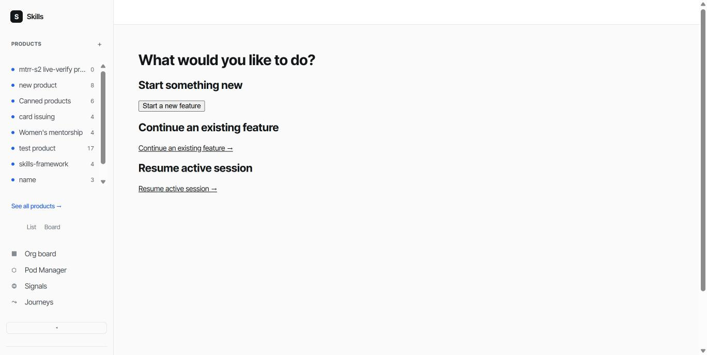

# Playback Walkthrough: 2026-06-14-web-ui-pm-flow

**Captured:** 2026-10-18, live against `https://wuce-staging.fly.dev`, logged in as the real operator account — the first real, non-synthetic capture produced after `fpd-s5` fixed the two gaps (AC-table-format mismatch, screenshot filename collision) that blocked this from working before.

## pmf.3 — Context-aware orientation wizard — three-step session start

### AC1 — Step 1 three named options

Real screenshot of `/journey/wizard` (Step 1, no `view` query param), captured live:

The page title reads "Project selection" and shows the three real option cards `pmf.3`'s own DoD describes: "Start something new" (with a real "Start a new feature" button), "Continue an existing feature", and "Resume active session" — matching `pmf.3-dod.md`'s own AC1 text exactly.

## How this package was produced

Captured via the operator's own authenticated Chrome session (not `scripts/playback-capture.js`'s own Playwright-driven path, which would need its own separate login this session cannot perform against a non-local host — see `fpd-s5`'s own story, Out of Scope item 1, and `fpd-s1` AC3's standing RISK-ACCEPT). The file is saved as `AC1.png` but the underlying bytes are a JPEG — no image-conversion tool was available in this sandbox to re-encode it as a true PNG; Chrome's own image decoder sniffs real content rather than trusting the extension, so it renders correctly regardless. Same transparency note as this feature's own earlier (now superseded) capture attempt.

This package replaces the earlier hand-authored, pre-`fpd-s5` version of this package, which used the old flat (non-story-namespaced) path convention and didn't exercise the real AC-table parsing fpd-s5 fixed.
