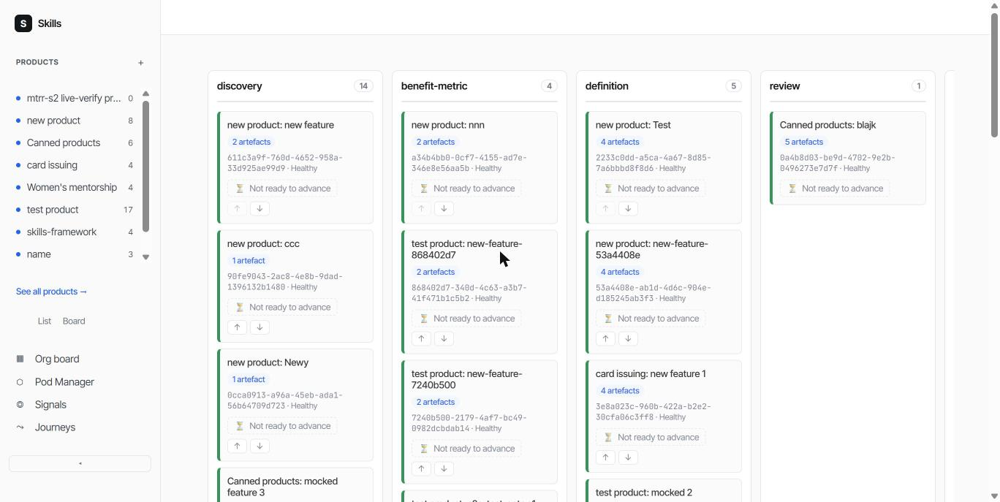

# Playback Walkthrough: 2026-06-14-web-ui-pm-flow

**Captured:** 2026-10-18, live against `https://wuce-staging.fly.dev`, logged in as the real operator account.

**How this package was produced:** this feature's own DoD files do not use the `## AC Coverage` table format that `fpd-s4`'s per-AC media-resolution code depends on (`pmf.3-dod.md` uses a different `## AC Verification` table shape; `pmf.1`/`pmf.2` have no per-story DoD file at all) — found live while attempting a real capture for the `feature-playback-demo` feature itself, logged as a gap in `workspace/capture-log.md` (2026-10-18). Because of that, this package was captured and written by hand rather than via `scripts/playback-capture.js`'s own automated flow, and the `/playback/<slug>` review page will show each story's own "No AC Coverage data available for this story yet" empty branch rather than per-AC screenshots — this file exists purely to exercise `/playback`'s list-entry and review-page-shell rendering with a real, non-synthetic feature.

## Kanban Board

The feature's own headline deliverable (`pmf.1`/`pmf.2`): a real, styled, interactive Kanban board at `/dashboard?view=board`, replacing the old read-only flat table. Captured live:

Real columns (`discovery`, `benefit-metric`, `definition`, `review`, ...) populated with real feature cards, each showing artefact count, ownership hash, health status, and advance/demote controls — exactly as `pmf.1`'s own AC describes.

**Note on the screenshot file:** saved as `AC1.png` (the filename convention `resolveScreenshotPathForAc` expects), but the actual bytes are JPEG — no image-conversion tool (ImageMagick/ffmpeg/sharp) was available in this sandbox to re-encode it as a true PNG. Chrome's own image decoder sniffs the real file content rather than trusting the extension, so it renders correctly regardless; flagged here for transparency, not hidden.

## Known gaps this capture surfaced

1. **AC-table format gap** (this file's own existence, above): no feature outside `feature-playback-demo` itself currently has a DoD using the `## AC Coverage` heading/column shape `parseDodAcCoverage` parses.
2. **Screenshot filename collision** (found separately, logged in `workspace/capture-log.md` 2026-10-18): `artefacts/<featureSlug>/playback/screenshots/<acId>.png` is keyed by feature-slug + AC-id only, with no story-slug component — a real capture against a multi-story feature where AC numbering restarts per story (e.g. `feature-playback-demo` itself) would silently collide.

Neither gap was fixed as part of this capture — both need their own short-track story.
