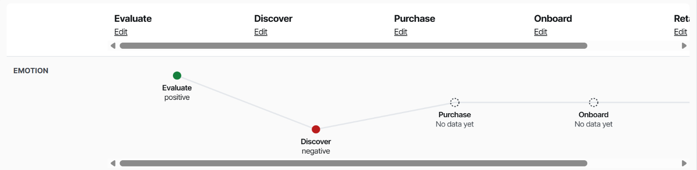
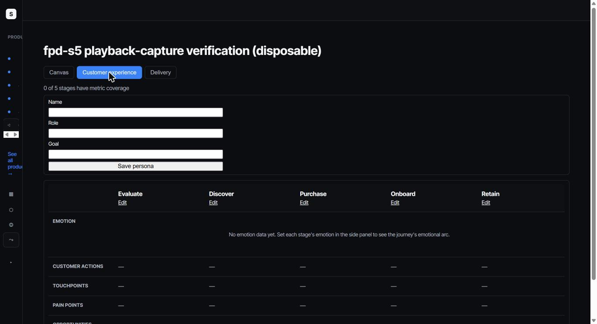
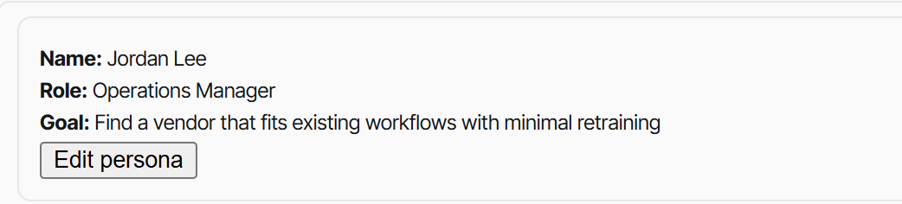
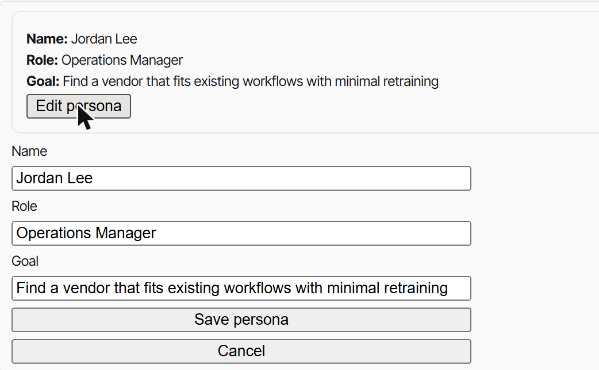
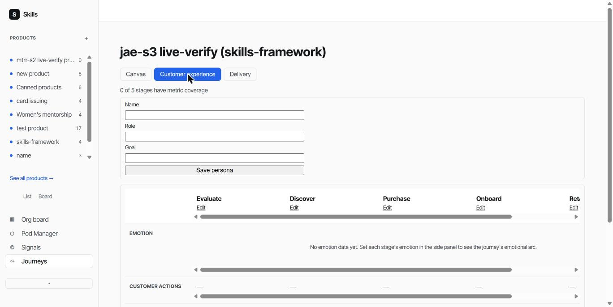
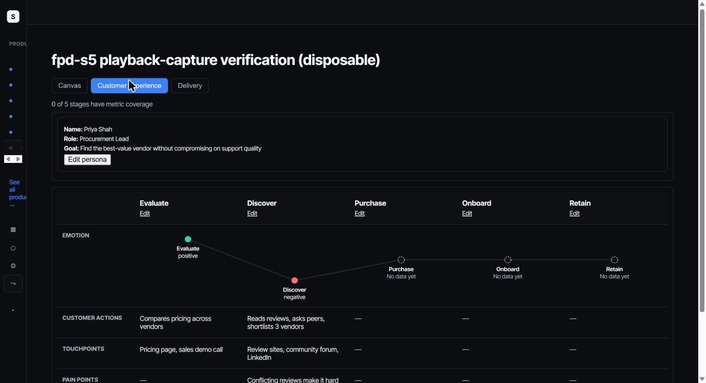

# Playback Walkthrough: 2026-10-11-journey-cx-redesign

<!-- story: jcx-hotfix1 -->
## The trigger route no longer 500s on a real Postgres join — The trigger route no longer 500s on a real Postgres join

Root cause captured directly from real staging logs (`flyctl logs -a wuce-staging`): `error: column reference "id" is ambiguous` at `journeys.js:529` inside `handleTriggerPlaceholderFeature`. Fix qualifies every SELECT column with the `cjs.` alias, directly eliminating the exact ambiguity the error names. Unit tests (9/9) pass with the corrected SQL text.

<!-- story: jcx-hotfix2 -->
## AC1 — AC1

The persona-save route accepts the client's real POST request and reaches the real handler. `check-jcx-hotfix2-persona-route-method.js`: confirmed RED against the bug (200 + HTML catch-all body) and GREEN against the fix (real 404 from `handlePatchJourneyPersona` on an unknown journey id)

<!-- story: jcx-hotfix3 -->
## AC1 — AC1

The swimlane grid is visible only in the Customer experience view. `check-jcx-hotfix3-cx-grid-visibility.js`: confirmed RED against the bug (grid stayed visible even in the default canvas view) and GREEN against the fix (hidden by default, visible in Customer experience, hidden again in Delivery)

<!-- story: jcx-hotfix4 -->
## AC1 — AC1

"+ Add stage" produces a visible, focused input regardless of active view. `check-jcx-hotfix4-add-stage-visibility.js`: confirmed RED against the bug (Canvas/Customer-experience scenarios failed, Delivery passed) and GREEN against the fix (all 3 scenarios pass)

<!-- story: jcx-s1 -->
## AC1 — placeholder mapping written with explicit `mapping_state`

`check-jcx-s1-placeholder-feature.js`: "AC1: placeholder mapping created with mapping_state=placeholder, feature_slug holds the name"

<!-- story: jcx-s1 -->
## AC2 — trigger seeds a new `/discovery` session from stage context

`check-jcx-s1-placeholder-feature.js`: "AC2: trigger creates a real artefacts/ folder and seeds discovery.md Section 1 only" — real `fs` state, not mocked

<!-- story: jcx-s1 -->
## AC3 — cross-tenant stage/mapping id returns 404, not 403

Two tests: "AC3 (creation): cross-tenant stage id returns 404 and makes zero mutation" + "AC3 (trigger): cross-tenant mapping id returns 404, no folder created"

<!-- story: jcx-s1 -->
## AC4 — placeholder and real feature mapping coexist on a stage

"AC4: a placeholder and a real mapping coexist on the same stage"

<!-- story: jcx-s1 -->
## AC5 — placeholder renders with distinct class + "Placeholder" label

"AC5: a placeholder mapping renders with sw-mapping--placeholder + Placeholder label, never the warning markup" (real handler output, regex-scoped to the row's own markup) PLUS "(UI, E2E) clicking 'Add placeholder' reveals the form..." (`getComputedStyle` visibility assertion)

<!-- story: jcx-s2 -->
## AC1 — approval converts placeholder → linked, feature_slug updates

`check-jcx-s2-placeholder-conversion.js`: "AC1: approval converts the mapping to linked with the real feature slug" — real `fs.readFileSync` against a real temp `discovery.md` fixture, not a mocked status check

<!-- story: jcx-s2 -->
## AC2 — unapproved discovery leaves mapping untouched

"AC2: an unapproved discovery leaves the mapping untouched"

<!-- story: jcx-s2 -->
## AC3 — independent conversion across two mappings

"AC3: two independent placeholder mappings convert independently" — asserts exactly one UPDATE, targeting only the approved mapping's own id

<!-- story: jcx-s2 -->
## AC4 — abandoned trigger persists indefinitely

"AC4: an abandoned (never-triggered) placeholder never auto-converts"

<!-- story: jcx-s3 -->
## AC1 — connected curve tracks emotion position

`tests/e2e/jcx-s3-emotion-curve.spec.js` (written, correctly reaches real server dispatch, blocked by a separate pre-existing gap — see UI-evidence gate below)

Video: [jcx-s3/video/page@c5978b31488aa83e5ea7f1633f7af468.webm](jcx-s3/video/page@c5978b31488aa83e5ea7f1633f7af468.webm) ([captions](jcx-s3/video/page@c5978b31488aa83e5ea7f1633f7af468.vtt), [transcript](jcx-s3/video/page@c5978b31488aa83e5ea7f1633f7af468.transcript.txt)) — real capture against wuce-staging, linked manually per `feature-playback/SKILL.md`'s own documented Step 3 gap (no automatic video-embed function yet)

<!-- story: jcx-s3 -->
## AC2 — missing-emotion stage shows a distinct marker, connects around it

`check-jcx-s3-emotion-curve.js`: "AC4 (empty-state marker)" unit test, confirming `sw-emotion-curve-point--unset` + "No data yet" text renders instead of a silent gap

<!-- story: jcx-s3 -->
## AC3 — whole-journey empty state

`check-jcx-s3-emotion-curve.js`: "AC3: a journey with zero emotion data shows the full empty state, not a broken line"

<!-- story: jcx-s3 -->
## AC4 — text label alongside colour (MC-A11Y-02)

`check-jcx-s3-emotion-curve.js`: "AC4: every curve point carries a text label matching its emotion value" — all 4 emotion values tested

<!-- story: jcx-s3 -->
## AC5 — accessible linear structure for screen readers

`check-jcx-s3-emotion-curve.js`: "AC5" — asserts `aria-hidden="true"` on the SVG and a visually-hidden `<ul>` listing every stage/emotion in document order

<!-- story: jcx-s4 -->
## AC1 — suggestions offered from scanned discovery.md files, raw text only

`check-jcx-s4-persona-card.js`: "AC1 (unit)" (raw-text extraction), "AC1 (integration)" (product-scoped), "(UI, E2E) clicking a suggestion fills the reference text area, never auto-splitting into the 3 fields"

<!-- story: jcx-s4 -->
## AC2 — no features/no persona found → blank form, no error

"AC2: zero feature slugs returns an empty suggestions array, no error" + "AC2 (missing discovery.md)"

<!-- story: jcx-s4 -->
## AC3 — selecting/typing a persona saves to the 3 new columns

"AC3: saving a persona writes persona_name/persona_role/persona_goal via one UPDATE" + "(UI, E2E) submitting the editor form POSTs all 3 persona fields to the save route"

<!-- story: jcx-s4 -->
## AC4 — re-opening editor shows saved persona, not stale suggestions

"AC4: a journey with a saved persona renders it, not the original suggestions" — exercises the real `handleGetJourneyCanvas` handler end to end

<!-- story: jcx-s4 -->
## AC5 — multiple distinct personas shown separately, not merged

"AC5: two distinct personas under the same product are returned as separate entries, not merged"

<!-- story: jcx-s5 -->
## AC1 — AC1

Cross-tenant placeholder-feature creation → 404, zero writes. `check-jcx-s5-authorization.js`: "AC1: cross-tenant placeholder-feature creation returns 404 and makes zero writes"

<!-- story: jcx-s5 -->
## AC2 — AC2

Cross-tenant trigger → 404, no folder/state created. `check-jcx-s5-authorization.js`: "AC2: cross-tenant trigger returns 404, no folder or pipeline-state entry created"

<!-- story: jcx-s5 -->
## AC3 — AC3

Viewer-role session → 403, real server dispatch. `check-jcx-s5-authorization.js`: "AC3" — real `server.js` router dispatch via a seeded viewer-role session (`login: 'e2e-viewer'`), reusing `check-vrne-s4-edge-case-gate.js`'s own harness verbatim; confirms `requireNonViewer` is wired on both routes, not just assumed

<!-- story: jcx-s5 -->
## AC4 — AC4

Cross-tenant mapping-conversion → 404, no partial conversion. `check-jcx-s5-authorization.js`: "AC4: cross-tenant mapping-conversion returns 404 with zero partial conversion" — confirms the tenant-scoped journey-row SELECT 404s before `checkPlaceholderConversions` ever runs

<!-- story: jcx-s5 -->
## AC5 — AC5

No regression. Full suite run: 744 files, 0 failed

<!-- story: jcx-s6 -->
## AC1 — AC1

Stages render left-to-right as columns. `check-jcx-s6-swimlane-grid.js` + E2E spec written; live-confirmed on staging (screenshot: Evaluate/Discover/Purchase as column headers)

<!-- story: jcx-s6 -->
## AC2 — AC2

Swimlane rows (Emotion, Customer actions, Touchpoints, Pain points, Opportunities) aligned under stage columns. Live-confirmed on staging

<!-- story: jcx-s6 -->
## AC3 — AC3

Curve carries stage names on-chart, fills its row. Live-confirmed on staging (stage names visible directly on the curve)

<!-- story: jcx-s6 -->
## AC4 — AC4

`customer_actions`/`touchpoints` surfaced as their own rows — live-confirmed (previously absent, now showing "Not set"/real values)

<!-- story: jcx-s6 -->
## AC5 — AC5

Accessible linear structure covers every field, in document order

<!-- story: jcx-s6 -->
## AC6 — AC6

CX tab visually distinct from Delivery (`sw-cx-swimlane-grid` class) — live-confirmed, and the `jcx-hotfix3` fix confirms the distinction holds correctly across view switches too

<!-- story: jcx-s6 -->
## AC7 — AC7

Many-stage horizontal scroll with pinned labels. E2E spec written, genuinely attempted against real local Postgres, reaches real dispatch, blocked by the already-tracked dashboard CSRF gap (`jcx-s3`'s own RISK-ACCEPT, 2026-10-13)

<!-- story: jcx-s7 -->
## AC1 — AC1

Save-error state no longer reuses the success-colored class; persistent `Saving…`/`Saved`/`Failed to save — Retry` states; auto-hide timer removed entirely, resolving review finding 1-M1's timer-race concern by eliminating the root cause. `check-jcx-s7-panel-feedback-and-polish.js` AC1a/b/c: confirmed RED (7/8 originally failed against pre-change code, including AC1a/b/c) and GREEN after the fix

<!-- story: jcx-s7 -->
## AC2 — AC2

`window.location.reload()` removed from the stage-add success path; new stage patched into the DOM from the POST response's own `{id, name, position}`; active view confirmed unchanged after save

<!-- story: jcx-s7 -->
## AC3 — AC3

Header cell is now a single-click/keyboard target (functional: `check-jcx-s7-panel-feedback-and-polish.js` AC3a/AC3b, resolving review finding 1-M2's double-fire concern); visual/size portion (real click-target area, keyboard focus-visible outline) covered by `tests/e2e/jcx-s7-panel-entry-and-save-feedback.spec.js`, written per the DoR's own B2 classification

<!-- story: jcx-s7 -->
## AC4 — AC4

Empty field values and empty/default stage names render with the muted `sw-cx-grid-cell--empty`/`sw-stage-name--empty` treatment; `check-ep3-s1-customer-experience-view.js`'s own AC2 re-pointed from the literal `"Not set"` string to this new marker, confirmed passing

<!-- story: jcx-s7 -->
## AC5 — AC5

Grid row padding (`8px 0`) and column-gap (`8px`) confirmed via jsdom `getComputedStyle` against the real rendered `<style>` block

<!-- story: ncdv-s2 -->
## Local Postgres connects without a forced-SSL error, real Neon/staging/production behavior unchanged — Local Postgres connects without a forced-SSL error, real Neon/staging/production behavior unchanged

`check-ncdv-s2-local-postgres-ssl.js` (2/2) PLUS a real disposable `postgres:16-alpine` Docker container, `migrateSchema()`/`listJourneys()` both connecting and querying cleanly with no SSL error PLUS a real E2E spec re-run confirming the SSL error specifically is gone (it now fails at a different, separate, already-known gap)

## Metric Signal

- **M2 — Placeholder-feature trigger actually used**:  —  (measured ) | Target: ≥1 placeholder feature triggered from a journey stage and reaching `/discovery` approval, within 4 weeks of release
- **M1 — Operator CX judgment vs. the reference bar**:  —  (measured ) | Target: Operator judges the redesigned tab as genuinely matching or approaching the reference examples' quality — same judgment-scale convention as the prior epic's own M2 ("Operator CX judgment vs. the list view it replaced")
- **M1 — Operator CX judgment vs. the reference bar**:  —  (measured ) | Target: Operator judges the redesigned tab as genuinely matching or approaching the reference examples' quality — same judgment-scale convention as the prior epic's own M2 ("Operator CX judgment vs. the list view it replaced")
- **M1 — Operator CX judgment vs. the reference bar**:  —  (measured ) | Target: Operator judges the redesigned tab as genuinely matching or approaching the reference examples' quality — same judgment-scale convention as the prior epic's own M2 ("Operator CX judgment vs. the list view it replaced")
- **M2 — Placeholder-feature trigger actually used**:  —  (measured ) | Target: ≥1 placeholder feature triggered from a journey stage and reaching `/discovery` approval, within 4 weeks of release
- **M2 — Placeholder-feature trigger actually used**:  —  (measured ) | Target: ≥1 placeholder feature triggered from a journey stage and reaching `/discovery` approval, within 4 weeks of release
- **M1 — Operator CX judgment vs. the reference bar**:  —  (measured ) | Target: Operator judges the redesigned tab as genuinely matching or approaching the reference examples' quality — same judgment-scale convention as the prior epic's own M2 ("Operator CX judgment vs. the list view it replaced")
- **M3 — Emotion/persona data actually populated**:  —  (measured ) | Target: ≥25% of touched stages have `emotion` populated within 4 weeks of release — a conservative target given this is genuinely new behaviour operators haven't used before
- **M1 — Operator CX judgment vs. the reference bar**:  —  (measured ) | Target: Operator judges the redesigned tab as genuinely matching or approaching the reference examples' quality — same judgment-scale convention as the prior epic's own M2 ("Operator CX judgment vs. the list view it replaced")
- **M2 — Placeholder-feature trigger actually used**:  —  (measured ) | Target: ≥1 placeholder feature triggered from a journey stage and reaching `/discovery` approval, within 4 weeks of release
- **M1 — Operator CX judgment vs. the reference bar**:  —  (measured ) | Target: Operator judges the redesigned tab as genuinely matching or approaching the reference examples' quality — same judgment-scale convention as the prior epic's own M2 ("Operator CX judgment vs. the list view it replaced")
- **M1 — Operator CX judgment vs. the reference bar**:  —  (measured ) | Target: Operator judges the redesigned tab as genuinely matching or approaching the reference examples' quality — same judgment-scale convention as the prior epic's own M2 ("Operator CX judgment vs. the list view it replaced")
- **None directly — this is a developer-experience/testing-infrastructure fix, not a product-facing feature contributing to any of this feature's own M1/M2/M3 metrics**:  —  (measured )